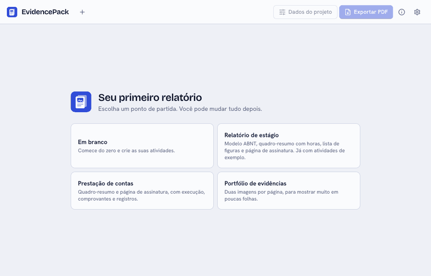
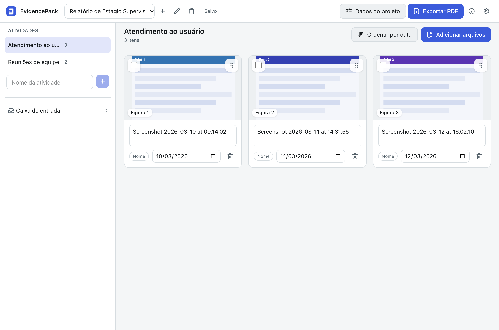
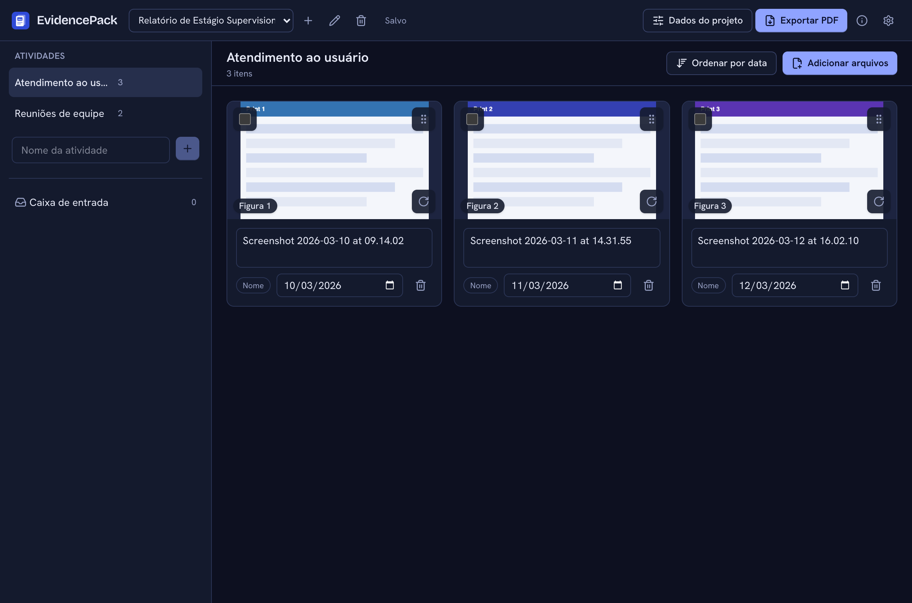

# EvidencePack

[Português](README.md)

Turn screenshots, photos and receipts into an organized PDF report with a cover, contents and numbered figures, and into a ZIP for accountability.



| Light                                                                | Dark                                                               |
| -------------------------------------------------------------------- | ------------------------------------------------------------------ |
|  |  |

## Why it exists

In internships and projects, proving your activities means gathering dozens of screenshots and photos and building a report by hand, with captions, dates and a table of contents. EvidencePack does the assembly: drop the files, name the activities and export.

## Download

Get the installer from the [Releases](../../releases) page:

- **macOS:** `EvidencePack_x.y.z_universal.dmg`
- **Windows:** `EvidencePack_x.y.z_x64-setup.exe`

## First launch

The app is not signed with a paid certificate because it is a free personal project, so the system shows a warning the first time.

**macOS:** open the `.dmg`, drag EvidencePack to Applications and open it. If the system blocks it, go to System Settings → Privacy & Security and click "Open Anyway". If you see "is damaged", run this in Terminal:

```sh
xattr -cr /Applications/EvidencePack.app
```

**Windows:** the installer does not ask for administrator rights. If SmartScreen shows up, click "More info" and then "Run anyway".

## How to use

1. Create a project and fill in the cover details under "Project details". That is also where the template (Simple or ABNT), the cover logo, the list of figures and the declaration and signature page live.
2. Create the activities in the sidebar.
3. Drop screenshots, photos and PDFs on the chosen activity. The date comes from EXIF, the file name or the file date, and the card badge shows where it came from. If the activities have periods, a file with a reliable date (EXIF or name) goes straight to the activity whose period contains it.
4. Tweak captions and dates on the cards, drag to reorder or use "Sort by date".
5. Export the PDF (cover, contents, one section per activity, numbered figures) or the ZIP with the originals and a CSV index.
6. To keep a project or move it to another computer, use "Save a project copy" (`.evpack`, originals included) and "Open a project copy".

## What it does and does not do

It copies files into the project folder (originals are never touched), detects duplicates by SHA-256, reads photo dates and orientation, makes thumbnails, re-encodes images for the PDF with no metadata at all (the location of your photos does not go into the PDF), attaches whole PDFs with an identifying label and saves the project automatically. The ZIP keeps the originals untouched in per-activity folders with an `indice.csv` (UTF-8 with BOM, `;` separated) that opens straight in Brazilian Excel.

It does not:

- Guarantee ABNT compliance. The ABNT template is "inspired by ABNT" (NBR 14724 margins, 12 pt text, 1.5 spacing, page number at the top right); check your institution's rules before handing in.
- Edit images or read their content.
- Open HEIC photos on Windows; export them as JPG first. Password-protected PDFs are refused.
- Keep links and forms inside attached PDFs.

## Privacy

Everything stays on your computer, in the app's data folder. There is no account, telemetry or external connection, and logs never hold file names or content.

## Run locally

Requirements: Node.js LTS, pnpm, Rust (stable) and, on macOS, the Xcode Command Line Tools.

```sh
pnpm install
pnpm tauri dev
pnpm test
```

## Roadmap

- More cover templates.
- Title page and abstract in the ABNT template.

## Contributing

See [CONTRIBUTING.md](CONTRIBUTING.md).

## License

[MIT](LICENSE)
