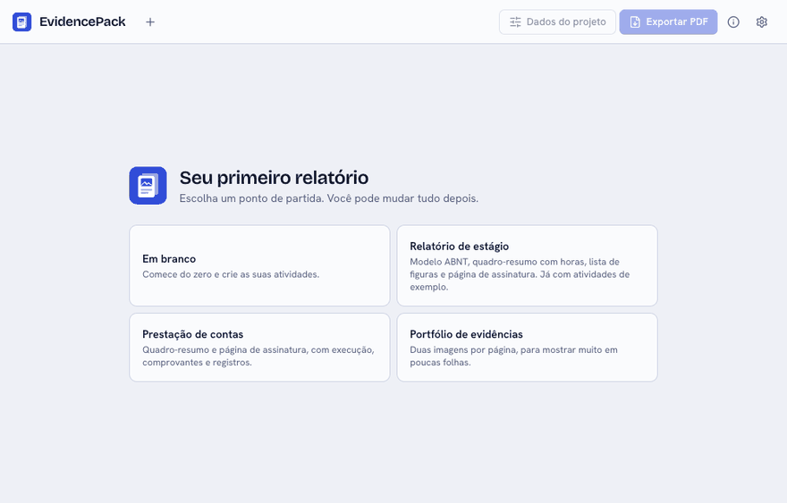
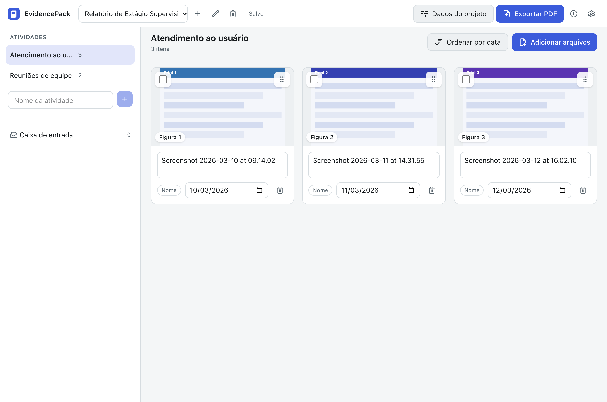
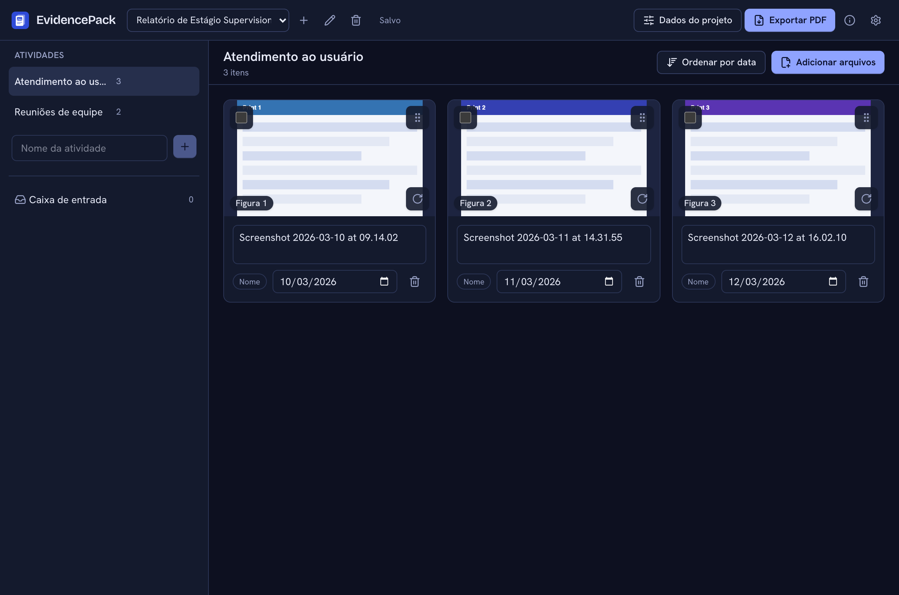

# EvidencePack

[English](README.en.md)

Transforme prints, fotos e comprovantes em um relatório em PDF organizado, com capa, sumário e figuras numeradas, e em um ZIP para prestação de contas.

<!-- Grave docs/demo.gif e descomente a linha abaixo. -->
<!--  -->

| Claro                                                                    | Escuro                                                                   |
| ------------------------------------------------------------------------ | ------------------------------------------------------------------------ |
|  |  |

## Por que existe

Em estágio e projetos, comprovar atividades significa juntar dezenas de prints e fotos e montar o relatório na mão, com legenda, data e sumário. O EvidencePack faz essa montagem: você arrasta os arquivos, dá nome às atividades e exporta.

## Download

Baixe o instalador na página de [Releases](../../releases):

- **macOS:** `EvidencePack_x.y.z_universal.dmg`
- **Windows:** `EvidencePack_x.y.z_x64-setup.exe`

## Primeira abertura

O app não é assinado com certificado pago, porque é um projeto pessoal e gratuito. Por isso o sistema mostra um aviso na primeira vez.

**macOS:** abra o `.dmg`, arraste o EvidencePack para Aplicativos e abra. Se o sistema bloquear, vá em Ajustes do Sistema → Privacidade e Segurança e clique em "Abrir Mesmo Assim". Se aparecer a mensagem "está danificado", rode no Terminal:

```sh
xattr -cr /Applications/EvidencePack.app
```

**Windows:** o instalador não pede administrador. Se o SmartScreen aparecer, clique em "Mais informações" e depois em "Executar assim mesmo".

## Como usar

1. Crie um projeto e preencha os dados da capa em "Dados do projeto".
2. Crie as atividades na barra lateral.
3. Arraste prints, fotos e PDFs para a atividade escolhida. A data vem do EXIF, do nome do arquivo ou da data do arquivo, e o selo do cartão mostra de onde veio.
4. Ajuste legendas e datas nos cartões, arraste para reordenar ou use "Ordenar por data".
5. Exporte o PDF (capa, sumário, uma seção por atividade, figuras numeradas) ou o ZIP com os originais e um índice em CSV.

## O que ele faz e o que não faz

Faz: copia os arquivos para a pasta do projeto (os originais não são tocados), detecta duplicatas por SHA-256, lê a data e a orientação das fotos, gera miniaturas, recodifica as imagens para o PDF sem nenhum metadado (a localização das suas fotos não vai para o PDF), anexa PDFs inteiros com uma etiqueta de identificação e salva o projeto automaticamente. O ZIP guarda os originais intactos em pastas por atividade, com um `indice.csv` (UTF-8 com BOM, separado por `;`) que abre direto no Excel brasileiro.

Não faz:

- O modelo ABNT ainda não existe; o modelo Simples é o único. Quando o ABNT chegar, será "inspirado na ABNT" e você deve conferir as regras da sua instituição.
- Não edita imagens nem lê o conteúdo delas.
- No Windows, fotos HEIC precisam ser exportadas como JPG antes. PDFs protegidos por senha são recusados.
- Links e formulários dentro dos PDFs anexados não são preservados.

## Privacidade

Tudo fica no seu computador, na pasta de dados do app. Não há conta, telemetria nem conexão externa, e os logs não guardam nomes de arquivos nem conteúdo.

## Rodar localmente

Pré-requisitos: Node.js LTS, pnpm, Rust (stable) e, no macOS, as Xcode Command Line Tools.

```sh
pnpm install
pnpm tauri dev
pnpm test
```

## Roadmap

- Modelo ABNT, lista de figuras e página de assinatura.
- Sugestão automática de atividade pela data e pelo período.
- Importar e exportar projeto como `.evpack`.
- Logo da instituição na capa.

## Contribuir

Veja o [CONTRIBUTING.md](CONTRIBUTING.md).

## Licença

[MIT](LICENSE)
